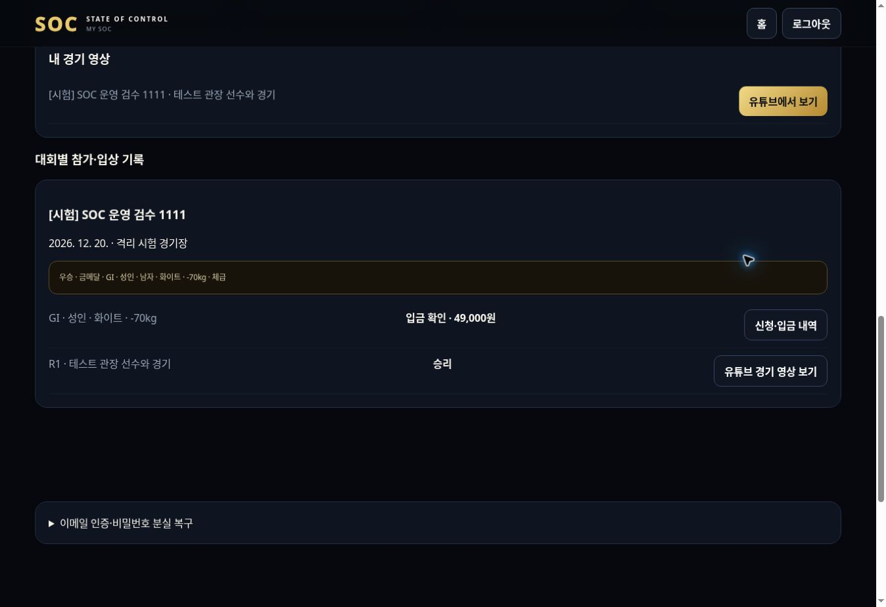

# SOC 검수 배포 직접 시험 기록

기준일: 2026-11-11 (한국시간). 정식 운영 전환 보고가 아닌 검수 기록입니다.

## 배포 및 데이터 범위

- 통합 개발 소스: `30387481110f97d1265b2f646d814a86f343e625`.
- 해당 소스를 검수 브랜치 환경변수와 연결한 Vercel Preview에서 아래 흐름을 실제 브라우저 화면으로 조작했습니다.
- 최초 배포 요청에 브랜치 대신 SHA만 전달되어 검수 전용 DB 설정이 적용되지 않았습니다. `preview_storage_not_isolated` 안전장치가 저장을 차단했습니다. 브랜치와 SHA를 함께 지정하여 해결했습니다.
- 아래 화면 시험에서 추가로 발견한 표시·안내 문제를 수정했습니다. 최종 URL과 최종 코드·CI 결과는 PR #2의 검수 기록을 기준으로 확인합니다.
- 실제 운영용 도메인으로 전환하거나 main에 병합하지 않았습니다.

## 배포 화면에서 직접 수행한 흐름

| 구분 | 실제 수행 | 결과 |
|---|---|---|
| 시험 로그인 | 일반회원·선수·관장·관리자·독립 승인 관리자 자동입력과 로그인·로그아웃 | 통과. 시험 계정 5개는 별도 DB에서만 작동 |
| 일반회원 권한 | 일반회원으로 관리자 URL 직접 접근 | 접근 차단 확인 |
| 도장 승인 | 관장 신청 → 관리자 반려 → 관장 사유 확인·주소 보완·재신청 → 관리자 승인 | 통과. 반려 사유 및 감사 이력 보존 |
| 소속·프로필 | 승인 도장을 관장 본인과 선수 프로필에 연결, 생일 8자리 연속 입력, 저장 후 내 SOC 이동 | 통과. 소속 도장에 등록 승인 표시 |
| 대회 설정 | 시험 대회 2개와 참가 부문 생성, 개최일시 12자리 연속 입력 | 통과 |
| 접수 개시 | 운영 검토 작성·증빙 제출 → 작성자와 다른 관리자 승인 → 접수 개시 | 통과 |
| 등록 요금 | 사전등록 49,000원, 별도 사전기간 없는 대회 일반등록 59,000원 | 금액 확인·신청·입금 안내 일치 |
| 참가신청 | 관장 겸 선수 1명, 선수 1명으로 같은 대회 신청 | 2건 저장 및 관리자 조회 확인 |
| 시험 입금 | 선수의 입금 신고 → 관리자 증빙·시각 입력 → 입금 원장 기록 | 통과. 실제 은행 거래를 사용하지 않음 |
| 참가증·계체 | 본인 화면에서 발급한 QR 문자열을 현장 화면에 입력, 두 선수 69kg 기록 | 체크인·계체 통과. 카메라·실물 스캐너 시험 아님 |
| 현장 경기 | 2인 대진 생성 → 매트 1·시간 배정 → 대진 공개 → 호출 → 시작 → 승자 저장 | 통과 |
| 내 SOC | 본인 참가비·소속·승리·금메달 기록·유튜브 링크 조회 | 통과 |
| 결과 정정 | 정정 사유·확인 → 기존 결과 무효 → 경기 재시작 → 승자 변경 | 통과. 마지막 시험 승자는 테스트 관장 |
| 취소·환불 | 별도 대회 미입금 신청 취소 → 재신청 → 시험 입금 → 선수 환불 요청 → 독립 승인 → 다른 관리자 환불 기록 | 통과. 59,000원 전액 시험 환불 기록. 승인자 자신의 지급 처리는 차단 |
| 상품 | 관리자 가상 상품·재고 3개 등록·공개 → 일반회원 주문 → 재고 2개 → 입금 신고 → 관리자 수납 → 운송장 기록 | 통과. 실제 상품·배송·송금 없음 |

같은 화면에 보이는 버튼 이름이 여러 개일 때 발생한 브라우저 조작 도구의 선택 충돌은 화면 범위를 지정하여 재확인했습니다. 네이티브 확인창 호출 시 도구 대기 오류가 있었지만, 열린 확인창을 처리하고 저장 결과를 다시 확인했습니다. 이러한 도구 오류를 서비스 저장 실패와 혼동하지 않았습니다.

## 직접 시험에서 찾고 수정한 사항

1. 홈페이지에서 관장·선수 시험 계정을 선택해도 관리자 로그인 창으로 열리던 문제를 수정했습니다.
2. 로그인 직후 새로고침 없이도 격리 시험 안내가 표시되도록 했습니다.
3. 도장 신청 저장 중 안내를 추가했습니다.
4. 현장 참가자·계체·부문·대진 표시에 남은 영문 상태를 한국어로 바꿨습니다.
5. 선수 참가증 목록과 신청내역에 내부 대회 ID 대신 대회명을 표시하도록 했습니다.
6. 여러 대회의 입금을 구분하도록 입금 선택 목록과 상세에 대회명을 표시했습니다. 목록을 불러오는 동안 처리 양식이 먼저 활성화되지 않도록 했습니다.
7. 동시 화면 갱신에서 같은 알림이 중복 표시되던 문제를 수정하고, 응답 순서가 바뀌는 시험을 추가했습니다.
8. 상품 잔여 수량은 ‘개’, 훈련 잔여 정원은 ‘명’으로 구분했습니다.

## 데이터 보존 확인

직접 시험 종료 후 DB를 읽어 대조했습니다.

| 데이터베이스 | 확인 내용 |
|---|---|
| 기존 검수 회원 DB `neondb` | 회원 3명·도장 1건 유지. 시험 대회·신청·입출금 원장 없음 |
| 격리 시험 DB `soc_demo` | 시험 계정 5명, 도장 1건, 대회 2개, 신청 4건, 경기 1개, 메달 2개, 대회 입출금 원장 4건, 상품 1개·주문 1건·사업 수납 원장 1건 |

대회 시험 입금 157,000원·환불 59,000원, 상품 시험 입금 10,000원은 모두 가상 시험 기록입니다. 실제 은행 잔액이나 매출로 사용할 수 없습니다. 기존 회원·도장 원본을 삭제하거나 초기화하지 않았습니다. 운영 DB는 이번 작업에서 변경하지 않았으며 현재 연결 권한을 통한 실제 운영 데이터 대조는 미확인입니다.

## 자동시험과 직접 시험의 구분

- 자동시험: 126개 서버·데이터·권한 시험. 별도로 격리 Chromium 화면의 가입부터 경기 결과·환불·사업 처리까지 시험.
- 반응형 목록화: 34개 페이지, PC 1365px·모바일 360px에서 보이는 665개 입력·버튼·링크. 가로 넘침 검사. 모든 조건별 조합을 665번 실행했다는 의미는 아닙니다.
- 이번 배포 화면 직접 시험: 위 표의 실제 조작 흐름. 자동시험과 동일한 범위를 전부 수동 반복하지는 않았습니다.
- 회원가입·메일 인증·비밀번호 복구는 격리 발송함을 사용한 자동 화면 시험을 통과했습니다. 공개 시험 계정은 고정 계정이므로 실제 이메일 수신 시험을 대신하지 않습니다.
- 유튜브는 저장된 URL과 새 창 연결 기능을 확인했습니다. 시험 링크는 실제 경기 영상이 아니며 실제 재생은 확인하지 않았습니다.
- 지원·프로·훈련 정산·심판 수당·공지·후원계약 처리는 자동 화면/API 시험을 수행했습니다. 이번 배포에서 모든 개별 계약·정산을 수동 재실행한 것은 아닙니다.
- 실제 휴대전화, 카메라, 프린터, 스캐너, 은행 송금, 운영 메일 수신은 미시험입니다.

## 아직 남은 사항

- 운영 메일 발송 연결, 실제 운영 DB 접근·백업 검증, 실제 수납 계좌와 운영 주체·약관·환불 정책 확정.
- 지역위원 자동 평가 산식, 선수 활동 매출 자동 배분 기준, 경영 손익·현금흐름 예측은 미구현. 근거 기록·승인·실제 지급과 입출금 집계까지 구현되어 있습니다.
- 대진 확정 후 선수 철회·재편성과 환불 예외를 연결하는 절차는 미완성입니다. 현재는 기존 경기·랭킹 기록 보호를 위해 환불을 차단합니다. 결과 정정 기능만으로 대진 확정이 해제되지는 않습니다. 허용 조건과 승인 기준을 정한 뒤 별도 보완해야 합니다.
- 지원금·모집 인원·일정 중 계획안은 실제 확정 모집 공고가 아닙니다. 사업별 승인된 조건을 입력한 후 운영해야 합니다.

따라서 전체 완성 또는 실운영 가능으로 판정하지 않습니다. 기능 목록과 항목별 상태는 `SOC_OPERATIONAL_REVIEW_20261111.md`를 함께 확인해 주세요.

## 화면 증빙

아래는 결과 정정 전 테스트 선수의 우승·경기 영상 조회 화면입니다. 이후 정정 시험에서 승자를 테스트 관장으로 변경했습니다.

